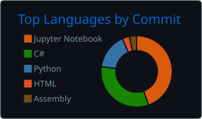
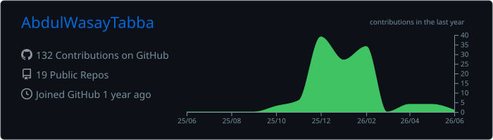
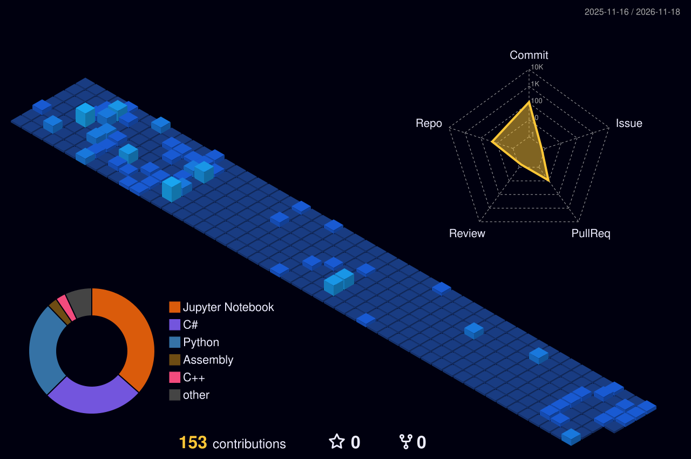

# Abdul Wasay Tabba

**AI/ML & automation engineer · .NET developer**

Computer Science student based in Pakistan. I build two kinds of things: LLM-agent and machine-learning projects in Python, and web applications on ASP.NET Core.

---

## Featured projects

### AI / ML

| Project | What it is | Stack |
|---|---|---|
| [BusinessConsultantBot (BizGPT)](https://github.com/AbdulWasayTabba/BusinessConsultantBot) | Multi-agent business consultant: a graph of agents profiles a business, pauses to ask clarifying questions, runs domain research agents, then a judge agent reviews the plan before a final report. | Python, LangGraph, Ollama (local LLMs), Streamlit |
| [ML-Journey](https://github.com/AbdulWasayTabba/ML-Journey) | My learning notebooks: perceptrons and backpropagation, ANN regression/classification, CNNs (LeNet, cats vs dogs), RNN/LSTM next-word prediction, dropout, early stopping, Keras Tuner. | Jupyter, TensorFlow/Keras, scikit-learn |
| [House-Prices-ML](https://github.com/AbdulWasayTabba/House-Prices-ML) | House price regression notebook. | Jupyter, pandas, scikit-learn, seaborn |

### .NET and systems

| Project | What it is | Stack |
|---|---|---|
| [OnlineVotingSystem](https://github.com/AbdulWasayTabba/OnlineVotingSystem) | Course project: online elections with voter, candidate and admin roles, layered into controllers, services and repositories. | ASP.NET Core 8 MVC, EF Core, SQL Server, JWT, BCrypt |
| [Clean_Pakistan](https://github.com/AbdulWasayTabba/Clean_Pakistan) | Civic-issue reporting: citizens file geotagged issues (potholes, garbage, water) that move through pending, verified and resolved. Web API plus a React client. | ASP.NET Core 8 Web API, EF Core, SQL Server, React (Vite) |
| [MaxLang](https://github.com/AbdulWasayTabba/MaxLang_AbdulWasayTabba) | A small language and its compiler pipeline in one C++ file: lexer, parser to AST, semantic checks, interpreter, with line/column error messages. | C++ |

---

## Tech I have used in these repositories

**Languages:** Python · C# · C++ · JavaScript · HTML/CSS · x86 Assembly

**Backend and web:** ASP.NET Core (MVC and Web API) · Entity Framework Core · FastAPI · Node.js · React (Vite)

**AI / ML:** LangGraph · Ollama · TensorFlow/Keras · scikit-learn · pandas · NumPy · Matplotlib · seaborn · Streamlit

**Databases:** SQL Server · PostgreSQL

**Tools:** Git · GitHub Actions · Visual Studio · VS Code · Jupyter

---

## 📊 GitHub Stats

  

  

---

## 🤝 Connect With Me

* 💼 LinkedIn: *(www.linkedin.com/in/abdul-wasay-tabba-853bb0369)*
* 📧 Email: *(wasaytabba704@gmail.com)*

---

⭐ *If you like my work, consider starring my repositories!*
